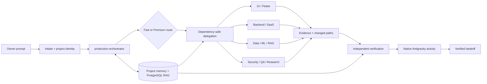

# Mansoor Farooq · Ultra Agent v4.4

<div align="center">

### Gemini-powered Antigravity agent orchestration for serious product engineering

**Plan clearly. Delegate safely. Verify everything. Ship with evidence.**

[](https://github.com/mansoor-farooq)
[](https://github.com/mansoor-farooq/my_ai_agent)
[](https://github.com/mansoor-farooq/my_ai_agent)
[](SKILL-PROVENANCE.json)

[Explore the repository](https://github.com/mansoor-farooq/my_ai_agent) · [Read the architecture](docs/architecture.md) · [Start quickly](docs/quickstart.md) · [See use cases](docs/use-cases.md)

</div>

> **Ultra Agent v4.4** is Mansoor Farooq's owner-led Gemini agent team for Antigravity: one manager, 14 focused specialists, local project memory, PostgreSQL RAG, evidence-gated verification and an owner-signed release path.

> **Distribution note:** This repository is public for product discovery. The source/package distribution remains private-only until every bundled skill has a verified source and redistribution licence. No credentials, private chats or hidden reasoning are shipped.

## Why this exists

Most agent demos stop at “ask a model and get text back.” Ultra Agent is designed for the part that happens after the prompt: reconstructing an unfamiliar repository, selecting the right specialist, preserving project memory, checking the result and handing back observable evidence.

Mansoor Farooq built this system for production-minded software architecture, premium product UI, Flutter and Android, .NET and Node.js backends, Python and PyTorch systems, workflow automation, application security, QA and release engineering.

## The product in one view

| Signal | What it means |
| --- | --- |
| **1 manager** | `production-orchestrator` owns intake, planning, delegation and final verification. |
| **14 specialists** | UI, Flutter, SaaS, ERP/schema, .NET, Node.js, Python, ML, cloud data, workflows, security, QA, research and hub operations. |
| **174 skills** | A portable, deduplicated skill library with explicit provenance tracking. |
| **4 governed rules** | Shared safety, quality and release contracts apply across the team. |
| **Local-first memory** | Project identity, decisions, evidence, conflicts and checkpoints stay scoped to the selected repository. |
| **Provider-free package** | No bundled MCP connectors, provider credentials or remote telemetry service. |

## Architecture at a glance



## How a task moves


## What makes the architecture premium

### Evidence before confidence

The manager reconstructs the repository before changing it. Research, assumptions, decisions, verification output and changed paths remain explicit so a human can audit the handoff.

### Memory that belongs to the project

Canonical project identity keeps temporary workers, evidence, checkpoints and PostgreSQL retrieval tied to the selected repository. Stale, malformed, unversioned or conflicting facts are surfaced instead of silently promoted.

### Speed without unsafe parallelism

Routine reversible tasks use Fast mode and a focused specialist. Architecture, security, migration, release and explicit research use Premium mode with planning, bounded research, independent verification and targeted recovery. Independent writes can run in safe waves; overlapping ownership is serialized.

### Native activity, not a second dashboard

Assignments, progress, blockers, handoffs and completed work appear in the Antigravity parent chat and native sub-agent panel. A separate browser dashboard is not required.

## Capability map

| Product area | Built-in capability | Primary specialists |
| --- | --- | --- |
| Product architecture | Reverse engineering, SaaS boundaries, migrations, release decisions | `saas-architect`, `enterprise-schema-architect` |
| UI and mobile | Premium UI systems, Flutter, Android, browser-visible QA | `mansoor-ui-specialist`, `flutter-mobile-specialist` |
| Backend engineering | .NET, ASP.NET Core, Node.js, TypeScript, Python services | `dotnet-backend-specialist`, `node-backend-specialist`, `python-backend-specialist` |
| Data and ML | PostgreSQL RAG, cloud data, PyTorch, MLOps and evidence boundaries | `cloud-data-engineer`, `ml-systems-specialist` |
| Operations | Workflow automation, application security, release readiness | `workflow-automation-specialist`, `application-security-reviewer`, `qa-release-specialist` |
| Research and maintenance | Deep research, documentation, package health and provenance | `research-docs-specialist`, `agent-hub-maintainer` |

## Who it is for

- **Founders and product teams** who need a reliable engineering partner across UI, backend and operations.
- **Senior engineers** who want architecture-aware delegation instead of a generic coding chatbot.
- **Teams with long-lived repositories** that need memory, evidence, checkpoints and safe handoffs.
- **Owners of private agent programs** who need a signed, portable Antigravity package with clear boundaries.

## Start here

### For a recipient

1. Install Antigravity and sign in with the target user's Gemini account.
2. Obtain the approved signed `mansoor-agent-hub.zip` from Mansoor Farooq's owner distribution. The [GitHub releases page](https://github.com/mansoor-farooq/my_ai_agent/releases) will be used when a public release artifact is intentionally published.
3. Extract the ZIP and run `Install-Mansoor-Agent-Team.cmd`.
4. Open a project, select `production-orchestrator`, and give it a task in chat.

The installer verifies the signed package and runs strict Antigravity validation before installing or updating the team. See the [recipient quickstart](docs/quickstart.md) for the full flow.

### For the owner

```cmd
cd /d E:\Agents
npm run build
```

The build refreshes source checksums, signs the portable ZIP, runs the doctor, validates the plugin and executes the focused test suite. See [owner setup](docs/quickstart.md#owner-build-and-release).

## Deep documentation

| Guide | Use it when you want to… |
| --- | --- |
| [Architecture](docs/architecture.md) | Understand manager boundaries, memory/RAG, delegation, verification and release safety. |
| [Quickstart](docs/quickstart.md) | Install the team, run the first task or build an owner-signed release. |
| [Use cases](docs/use-cases.md) | See how Fast, Premium, UI, backend, RAG, security and release tasks flow. |
| [Ultra Agent protocol](shared/ULTRA_AGENT_V2_PROTOCOL.md) | Read the runtime contract and project-scoped evidence model. |
| [Portfolio SEO copy](docs/PORTFOLIO_SEO.md) | Reuse accurate public product positioning and links. |
| [Skill provenance](SKILL-PROVENANCE.json) | Inspect source categories, declared licences and private-only boundaries. |

## Verification and release proof

The V4.4 release gate currently verifies:

- 87 discovered tests: **81 passing**, **0 failures**, 6 intentional provider-free RAG skips;
- 15 packaged agent profiles, 174 skills, 4 governed rules and zero provider connectors;
- owner-signed package checksums, strict Antigravity plugin validation and source integrity checks;
- benchmark envelopes for acceptance, latency, p95 timing and bounded failure reasons;
- checkpoint drift reporting, memory health diagnostics, activity summaries and expanded secret redaction.

The generated artifact is `dist/mansoor-agent-hub.zip`. Every build prints the exact SHA256 for the package that was produced.

## Fast and Premium modes

The manager selects the mode automatically. Fast mode handles routine reversible work with cached context and targeted verification. Premium mode handles architecture, security, production, release, payment, ML, migration and explicit research with planning, bounded research, specialist delegation, independent verification and evaluation. Missing Premium tools block the task instead of silently downgrading it.

## Trust, provenance and public boundaries

The public repository is a product showcase and discovery surface. The portable package remains private-only until the bundled skill inventory has complete source and redistribution review. `SKILL-PROVENANCE.json` is the source of truth; no licence or provenance is invented.

The package never includes provider credentials, customer data, private chats, hidden chain-of-thought or the private signing key. Tamper detection protects against accidental or ordinary unauthorized modification, but it is not unbreakable DRM.

## About Mansoor Farooq

**Mansoor Farooq** is the creator and owner of Ultra Agent. His engineering focus spans Antigravity and Gemini agent orchestration, software architecture, premium product UI, Flutter, Android, .NET, Node.js, Python, PyTorch, PostgreSQL, workflow automation, application security and release engineering.

- GitHub: [mansoor-farooq](https://github.com/mansoor-farooq)
- Repository: [my_ai_agent](https://github.com/mansoor-farooq/my_ai_agent)
- Releases: [Ultra Agent releases](https://github.com/mansoor-farooq/my_ai_agent/releases)

> **Search summary:** Mansoor Farooq's Ultra Agent v4.4 is a Gemini-powered Antigravity multi-agent system for software architecture, production UI, Flutter, .NET, Node.js, Python, PyTorch, PostgreSQL RAG, workflow automation, application security, QA automation and signed release engineering.
