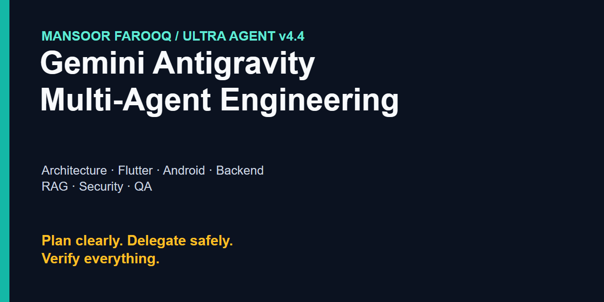
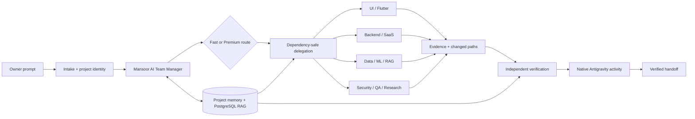
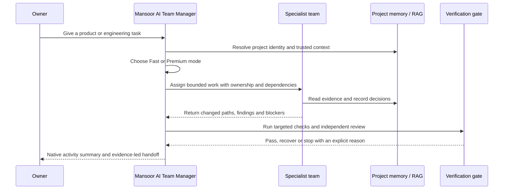

# Mansoor AI Team Manager | Antigravity, Gemini CLI & Codex Coding Agent

<div align="center">

### Antigravity-native AI coding team for software engineering, Flutter/Android, and live browser QA

**Plan clearly. Delegate safely. Verify everything. Ship with evidence.**

[](https://github.com/mansoor-farooq)
[](https://github.com/mansoor-farooq/my_ai_agent)
[](https://github.com/mansoor-farooq/my_ai_agent)
[](SKILL-PROVENANCE.json)

[Explore the repository](https://github.com/mansoor-farooq/my_ai_agent) · [Read the architecture](docs/architecture.md) · [Start quickly](docs/quickstart.md) · [See use cases](docs/use-cases.md)

</div>

> **Mansoor AI Team Manager** is an Antigravity-native multi-agent coding system that also supports Gemini CLI and Codex workflows: one main manager, 14 specialist agents, project memory, evidence-based verification, Flutter/Android engineering, and live Playwright browser QA.

Ultra Agent helps you plan, delegate and verify work across software architecture, production UI, Flutter, Android, .NET, Node.js, Python, PyTorch, PostgreSQL RAG, security, QA and release engineering.

Find this project for **AI coding agents**, **Antigravity agent teams**, **Gemini CLI coding agents**, **Codex custom agents**, **multi-agent software engineering**, **Flutter and Android development**, **Playwright CLI live browser automation**, and **QA regression testing**. The bundled QA specialist uses the main manager's project scope and reports observed browser evidence instead of acting as a separate orchestrator.

**Start with:** [quickstart](docs/quickstart.md) · [architecture](docs/architecture.md) · [use cases](docs/use-cases.md) · [releases](https://github.com/mansoor-farooq/my_ai_agent/releases)

> **Distribution note:** This repository is public for product discovery. The source/package distribution remains private-only until every bundled skill has a verified source and redistribution licence. No credentials, private chats or hidden reasoning are shipped.

## Why this exists

Most agent demos stop at “ask a model and get text back.” Ultra Agent is designed for the part that happens after the prompt: reconstructing an unfamiliar repository, selecting the right specialist, preserving project memory, checking the result and handing back observable evidence.

Mansoor Farooq built this system for production-minded software architecture, premium product UI, Flutter and Android, .NET and Node.js backends, Python and PyTorch systems, workflow automation, application security, QA and release engineering.

## The product in one view

| Signal | What it means |
| --- | --- |
| **1 manager** | **Mansoor AI Team Manager** (`production-orchestrator` internal id) owns intake, planning, delegation and final verification. |
| **14 specialists** | UI, Flutter, SaaS, ERP/schema, .NET, Node.js, Python, ML, cloud data, workflows, security, QA, research and hub operations. |
| **254 skills** | A portable, deduplicated skill library with explicit provenance tracking, including Dart/Flutter Android workflows, the Vercel UI pack and live-browser QA. |
| **5 governed rules** | A signed metadata registry covers architecture, Flutter/mobile, testing, SaaS and Antigravity-native orchestration; local customizations are preserved. |
| **Local-first memory** | Project identity, decisions, evidence, conflicts and checkpoints stay scoped to the selected repository. |
| **Local managed MCP** | The installed Antigravity plugin bundles its own managed-task MCP server; no per-project MCP config, provider key or remote telemetry service is required. |

## Architecture at a glance





## How a task moves



## What makes the architecture premium

### Evidence before confidence

The manager reconstructs the repository before changing it. Research, assumptions, decisions, verification output and changed paths remain explicit so a human can audit the handoff.

### Memory that belongs to the project

Canonical project identity keeps temporary workers, evidence, checkpoints and PostgreSQL retrieval tied to the selected repository. Stale, malformed, unversioned or conflicting facts are surfaced instead of silently promoted.

### Contract-first execution

Every target project has a visible, root-level contract made of `plan/`, `flow/`, `status/`, `logic/`, `requirements/` and `test-cases/`. The manager audits these folders read-only first; missing folders require owner approval before bootstrap. Accepted requirements and architecture decisions are append-only and versioned. The managed Node executor enforces typed write scopes and protected paths for actions routed through it. The bundled Antigravity PreToolUse hook blocks protected or out-of-workspace native file mutations, allows manifest-bound Tier 0/1 managed runs after the manager broker has issued its receipt, and uses the manager-auto lane for bounded non-delete work; delete/destructive, secrets, network, push/deploy and other critical effects stay in host `ask`/`deny`. Native changes remain outside the Node executor's effect ledger and idempotency guarantees.

The contract kernel is available through `node <hubRoot>/tools/ultra-agent-v2/contract.mjs audit|bootstrap` and is included in the portable package. `preflight.mjs` reports contract readiness without mutating the target project.

### Isolated task workspaces and reviewable delivery

The managed V4 runtime can pin a task to a detached Git worktree, resume only the same approved task/plan/base revision, and keep the owner checkout untouched while writes and registered checks run. Passing work produces a patch with a SHA-256 review ID; a trusted owner approval for that exact patch stages it in the main checkout. It never commits, pushes, or deploys automatically. This lane requires a trusted host adapter that calls the managed runtime; Antigravity's native editor is not automatically redirected into the worktree, and the package reports that boundary explicitly.

The Antigravity plugin bundles that host adapter as a local `mansoor-managed-runtime` MCP server. Antigravity loads it from the installed plugin's `mcp_config.json`; there is no per-project MCP file or separate MCP credential to configure. The manager passes the current project path to each tool call, while resumable worktrees live in plugin-specific local data. The Windows 10/11 launcher uses the Node runtime prepared by the installer. The feature is available when the plugin is installed and enabled; restart or reload Antigravity after upgrading.

### Persistent CLI and Android preview lane

The same local runtime can stay available outside the editor through `tools/ultra-agent-cli.mjs`. Start it once with `node tools/ultra-agent-cli.mjs start`; submit bounded work with `submit`, inspect `events`, resume or stop a run, and call `doctor` without creating a second memory system. The daemon stores queue state and redacted activity under the user's local application data, uses idempotency keys and reports `queued-host-unavailable` when Antigravity is closed. It never switches providers or bypasses the signed-in host session.

For Flutter/Android projects, the mobile lane detects `adb` and optional `scrcpy`, requires an explicit device serial when more than one device is online, starts only a Mansoor-owned mirror window, and emits a fail-closed evidence report. `scrcpy` is detected from the host; its binary is not bundled. A missing device, mirror or check remains `unverified`, never a false pass. This makes Android preview repeatable on Windows 10/11 while keeping host permissions and real-device evidence visible.

### Ready-to-use agent datasets

Managed task runs automatically record sanitized outcomes with manager and agent identities. Export with `node tools/agent-training-dataset.mjs export --dir <project>` to create `.agents/ultra-v4/training-datasets/Mansoor-AI-Team-Manager` and its separate `agents/<agent-id>/` datasets. Owner approval is required before passing outcomes enter `sft.jsonl`; unreviewed and failed cases stay in evaluation/hard-case files. Credentials, absolute local paths, raw chats and hidden reasoning are excluded. This prepares local data only; model training remains an explicit separate step.

### Speed without unsafe parallelism

Routine reversible tasks use Fast mode and a focused specialist. Architecture, security, migration, release and explicit research use Premium mode with planning, bounded research, independent verification and targeted recovery. Independent writes can run in safe waves; overlapping ownership is serialized.

### Native activity, not a second dashboard

Assignments, progress, blockers, handoffs and completed work appear in the Antigravity parent chat and native sub-agent panel. A separate browser dashboard is not required.

### UI specialist release gate

`mansoor-ui-specialist` is the priority web-interface specialist and now treats layout integrity as a release gate, not a styling preference. Before handoff it checks real component/state evidence, text wrapping and shrink rules, long-content and empty/error states, keyboard focus, 200% zoom, responsive breakpoints, and light/dark theme contrast. Fixed-height text boxes, clipped copy and inaccessible truncation are blockers. The specialist reuses the project’s existing routes, data contracts, permissions, tokens and primitives, then requires a rendered browser or project-preview inspection before calling the UI complete.

### Flutter/Android specialist release gate

`flutter-mobile-specialist` is the expert mobile UI/Android worker for adaptive Flutter and native Compose products. Its `flutter-mobile-master-engineer` skill routes work through project discovery, stack-preserving implementation and evidence-based verification. It covers compact/large screens, safe areas and keyboard behavior, loading/empty/error/offline/permission states, semantics, motion, native capability and OEM compatibility as relevant. It preserves existing navigation, API/database contracts, IDs, validation and permissions; arbitrary state-management or folder rewrites are outside a UI task.

### Codex mobile specialist

The portable bundle includes a Codex custom subagent at `.codex/agents/flutter-mobile-specialist.toml` and the shared master skill. On this machine, install them for all Codex workspaces with `npm run agents:install:codex`; the installer preserves unrelated custom skill/agent files and refuses to replace them. In Codex, ask the manager to delegate a bounded Flutter/Android workstream to `flutter-mobile-specialist`. The subagent inherits the parent session's model, tools and permission mode; its configuration cannot bypass Codex approvals.

### Release-quality gates

The hub includes reusable gates for real projects:

- Android runtime smoke: `node tools/android-runtime-smoke.mjs --package <application-id> --require-device --out <project>/.agents/android-runtime-smoke.json` (install, launch, back and optional deep-link evidence; offline/API-failure states remain explicit until an app-owned test hook exists).
- Flutter release gate: `node tools/flutter-release-gate.mjs --project <flutter-project> --out <project>/.agents/flutter-release-gate.json` (analyze, tests, APK build, size and measured-performance placeholders).
- Capability and manifest drift: `node tools/mobile-capability-preflight.mjs --project <project> --package <application-id> --capabilities auto --previous-report <old-report> --require-device`.
- Secret scan: `node tools/secret-scan.mjs <project>` (redacted findings only; values are never printed).
- Dedicated RAG CI: set `RAG_DB_NAME=mansoor_agent_rag_test` and `RAG_DB_PASSWORD`/`PGPASSWORD`, then run `node tools/rag-ci-gate.mjs`. A local PostgreSQL instance using trusted localhost authentication may be opted in with `RAG_DB_TRUST_AUTH=1` and an explicit loopback `RAG_DB_HOST`; the gate probes credentials before tests.
- Specialist benchmark: `node tools/agent-benchmark.mjs <records.json>` for acceptance, accuracy, p95 latency, regression and unsafe-action metrics.
- Antigravity supports Windows 10 and Windows 11. Host preflight reports platform support separately from sandbox status; Windows 10 is review-required and Windows 11 sandbox status remains unknown until the host probes it. The terminal sandbox specifically requires Windows 11 24H2+ with the August 2026 update.

The recommended device matrix is Samsung, Pixel and Xiaomi across Android 13, 14 and 16. A missing device or expired evidence stays `unverified` and blocks release claims.

### Capability wave

The reliability layer includes an idempotent managed-write adapter, ranked repository map, provenance-aware memory, bounded verifier convergence, redacted local traces, security fixtures and optional Flutter/Android Patrol/Maestro flow gates. The benchmark evaluator is ready, but no owner-approved live task corpus is bundled yet; no agent accuracy or competitor superiority claim is made. Native IDE tools are gated by the packaged PreToolUse hook, but the Node adapter does not track those native effects. On Windows 10, the CLI sandbox is unavailable, so host permission review remains required. Windows 11 is supported; sandbox capability must be probed on that machine.

## Capability map

| Product area | Built-in capability | Primary specialists |
| --- | --- | --- |
| Product architecture | Reverse engineering, SaaS boundaries, migrations, release decisions | `saas-architect`, `enterprise-schema-architect` |
| UI and mobile | Premium UI systems, Flutter, Android, browser-visible QA | `mansoor-ui-specialist`, `flutter-mobile-specialist` |
| Backend engineering | .NET, ASP.NET Core, Node.js, TypeScript, Python services | `dotnet-backend-specialist`, `node-backend-specialist`, `python-backend-specialist` |
| Data and ML | PostgreSQL RAG, cloud data, PyTorch, MLOps and evidence boundaries | `cloud-data-engineer`, `ml-systems-specialist` |
| Operations | Workflow automation, application security, release readiness | `workflow-automation-specialist`, `application-security-reviewer`, `qa-release-specialist` |
| Research and maintenance | Deep research, documentation, package health and provenance | `research-docs-specialist`, `agent-hub-maintainer` |

## Who it is for

- **Founders and product teams** who need a reliable engineering partner across UI, backend and operations.
- **Senior engineers** who want architecture-aware delegation instead of a generic coding chatbot.
- **Teams with long-lived repositories** that need memory, evidence, checkpoints and safe handoffs.
- **Owners of private agent programs** who need a signed, portable Antigravity package with clear boundaries.

## Start here

### Install from the repository URL

Once an approved signed GitHub release is published, Antigravity can use the repository URL as the install source. The bootstrap downloads the latest `mansoor-agent-hub.zip`, verifies its checksum and signed manifest, requests Windows administrator approval when needed and runs the packaged installer:

```cmd
Install-Ultra-Agent.cmd https://github.com/mansoor-farooq/my_ai_agent
```

The bootstrap accepts HTTPS GitHub URLs only. It does not execute arbitrary repository source, build an untrusted package or bypass the owner signature. If the repository has no signed release asset yet, it stops and reports that requirement.

### For a recipient

1. Install Antigravity. The signed installer prepares Gemini CLI; sign in to the target account on first use.
2. Obtain the approved signed `mansoor-agent-hub.zip` from Mansoor Farooq's owner distribution. The [GitHub releases page](https://github.com/mansoor-farooq/my_ai_agent/releases) will be used when a public release artifact is intentionally published.
3. Extract the ZIP and run `Install-Mansoor-Agent-Team.cmd`.
4. Open a project and use **Mansoor AI Team Manager** as the main agent. `production-orchestrator` remains an Antigravity compatibility key, not the user-facing agent identity.

The installer verifies the signed package and runs strict Antigravity validation before installing or updating the team. It also installs/updates Gemini CLI when npm manages it, then syncs all 15 agent profiles, the full 254-skill library, four domain policies and one Antigravity-native orchestration policy into the user's global Gemini CLI profile. Existing unrelated Gemini skills are kept separate under `mam-*` names. See the [recipient quickstart](docs/quickstart.md) for the full flow.

### For the owner

```cmd
cd /d E:\Agents
npm run build
```

The build refreshes source checksums, signs the portable ZIP, runs the doctor, validates the plugin and executes the focused test suite. It syncs the latest agent profiles, full skills and policies into the owner's global Gemini CLI profile. If a Mansoor Agent Hub installation already exists on that PC, it also runs the signed installer automatically, reports the update plan and verifies active-plugin/profile hashes. Old extracted packages are removed only after their owner signature verifies. Use `npm run build:package` when you only want a ZIP without touching the local installation. See [owner setup](docs/quickstart.md#owner-build-and-release).

## Deep documentation

| Guide | Use it when you want to… |
| --- | --- |
| [Architecture](docs/architecture.md) | Understand manager boundaries, memory/RAG, delegation, verification and release safety. |
| [Quickstart](docs/quickstart.md) | Install the team, run the first task or build an owner-signed release. |
| [Use cases](docs/use-cases.md) | See how Fast, Premium, UI, backend, RAG, security and release tasks flow. |
| [Ultra Agent protocol](shared/ULTRA_AGENT_V2_PROTOCOL.md) | Read the runtime contract and project-scoped evidence model. |
| [Portfolio SEO copy](docs/PORTFOLIO_SEO.md) | Reuse accurate public product positioning and links. |
| [Skill provenance](SKILL-PROVENANCE.json) | Inspect source categories, declared licences and private-only boundaries. |

## Verification and release proof

The V4.4 release gate currently verifies:

- `npm test`: test totals are generated from the current run; the ordinary suite may skip six PostgreSQL-backed checks without a dedicated test database. CI runs the full eight-case RAG file against the isolated `mansoor_agent_rag_test` service and rejects any skip.
- 15 packaged agent profiles, 254 skills, 5 governed rules and zero provider connectors;
- owner-signed package checksums, strict Antigravity plugin validation and source integrity checks;
- benchmark envelopes for acceptance, latency, p95 timing and bounded failure reasons;
- checkpoint drift reporting, memory health diagnostics, activity summaries, capability probes, manifest drift, runtime smoke and expanded secret redaction.

Each build creates a unique versioned archive such as `dist/mansoor-agent-hub-1.23.4-a1b2c3d4.zip`, so a running app or scanner cannot block replacement of an older ZIP. Every build prints the exact package path and SHA256.

## V5 trust and recovery hardening

The V5 lane adds provider-free controls that are testable on the local machine:

- verification commands run with a minimal allowlisted environment; provider tokens and secret-shaped variables are not inherited by default;
- queue and action-ledger state use cross-process locks, idempotency keys and bounded stale-lock recovery;
- capability preflight reports `available`, `enabled`, `verified-by-probe`, `unsupported` or `unknown` instead of guessing about Windows isolation;
- staged promotion receipts bind the exact manifest hash, approval receipt and observed file hashes;
- the risk-based Approval Broker records manager auto-approval for bounded work and blocks Tier 3 self-approval;
- installer journals, transactional active-package backup/rollback, release manifests, redacted local telemetry, benchmark manifests and Android evidence records are packaged for portable use.

These controls do not turn Antigravity hooks into an OS sandbox. Native editor writes remain host-controlled and must use the managed staged-promotion path for trusted evidence. Windows isolation, model selection, local-LLM fallback, physical Android coverage and public redistribution licensing are capability-gated; the kit reports `unknown`, `not-run` or `review-required` when the host, account, hardware or rights are not present. No human-level, device-matrix or automatic model-routing claim is made without captured evidence.

## Fast and Premium modes

The manager selects the mode automatically. Fast mode handles routine reversible work with cached context and targeted verification. Premium mode handles architecture, security, production, release, payment, ML, migration and explicit research with planning, bounded research, specialist delegation, independent verification and evaluation. Missing Premium tools block the task instead of silently downgrading it.

## Trust, provenance and public boundaries

The public repository is a product showcase and discovery surface. The portable package remains private-only until the bundled skill inventory has complete source and redistribution review. `SKILL-PROVENANCE.json` is the source of truth; no licence or provenance is invented.

## Risk-adaptive autonomy (V5 production lane)

`tools/ultra-agent-v5/approval-broker.mjs` authorizes scoped, manifest-bound non-delete work through **Mansoor AI Team Manager** after plan approval. Delete, format, truncate and disk-wipe actions require fresh owner review. The receipt remains bound to the manifest hash, nonce, policy version and expiry. Missing task scope or affected paths cannot be authorized.

Native shell commands use the bundled PreToolUse hook. In the owner-selected Turbo flow, ordinary commands, inline scripts and external Desktop writes use the manager auto lane; direct delete, format, truncate and disk-wipe operations return `force_ask`. Antigravity's configured rules still take precedence. Arbitrary shell code can construct destructive operations indirectly, so the hook is not an OS sandbox or a guarantee that every possible data-loss effect is recognized.

For repeated setup/optimizer work, a script may be registered by project and hash for an auditable record:

```text
node tools/ultra-agent-v5/manager-script-registry.mjs --register --script "C:\path\to\script.ps1" --project "E:\path\to\project"
```

The registry stores the project path, interpreter and SHA-256 content hash. Non-delete inline and external script commands no longer require a registry entry for Turbo execution. A registered script containing a recognized destructive operation still triggers a fresh owner prompt.

The installer merges desktop and CLI grants, adds a command wildcard Allow for the owner-selected Turbo flow, and adds Ask rules for direct data-loss commands. It retires the prior Mansoor-managed deny rules while preserving unrelated user rules. Explicit host Deny/Ask rules still win over Allow. CLI `agentMode: auto` remains the default; the command grant and hook reduce prompts on Windows without claiming that the CLI itself has the desktop Turbo preset. Delete/recreate work requires one owner review for the exact managed action before it executes.

### Existing-project refresh

Antigravity supports both global plugins (`%USERPROFILE%\\.gemini\\config\\plugins`) and workspace plugins (`<project>/.agents/plugins`). A project-level copy can therefore remain on an older Mansoor release even after the global plugin is updated. The installer now audits Antigravity's bounded project registry (`%USERPROFILE%\\.gemini\\config\\projects\\*.json`) and runs `tools/project-agent-refresh.mjs --mode sync-known` for every existing project it knows about. At task intake, the manager can also run `--mode sync` against one canonical project root. The refresh records `.agents/mansoor-agent-state.json`, compares the installed package fingerprint and permission-policy version, atomically updates only a managed workspace-level Mansoor plugin copy, keeps a rollback backup, and preserves any locally customized workspace plugin instead of overwriting it. Project permission overrides are never silently replaced: custom grants are reported as `project-override-preserved`, while projects with no custom grants inherit the latest global Mansoor policy. Application code, routes, APIs, requirements and project memory are not rewritten by this refresh. This gives every known project a deterministic update/audit path without scanning arbitrary drives.

`tools/ultra-agent-v5/readiness-gate.mjs` calculates the weighted production-readiness score, but hard safety failures cannot be averaged away. A 99% score is only `ready` when all mandatory release, audit, rollback, secret and unauthorized-Tier-3 gates pass; missing host/device/RAG evidence stays `unverified`. `evaluateMemoryEvidence` also rejects cross-project facts, stale evidence, missing citations, invalid hashes and contradictory records before they can be promoted to memory.

The package never includes provider credentials, customer data, private chats, hidden chain-of-thought or the private signing key. Tamper detection protects against accidental or ordinary unauthorized modification, but it is not unbreakable DRM.

## About Mansoor Farooq

**Mansoor Farooq** is the creator and owner of Ultra Agent. His engineering focus spans Antigravity and Gemini agent orchestration, software architecture, premium product UI, Flutter, Android, .NET, Node.js, Python, PyTorch, PostgreSQL, workflow automation, application security and release engineering.

- GitHub: [mansoor-farooq](https://github.com/mansoor-farooq)
- Repository: [my_ai_agent](https://github.com/mansoor-farooq/my_ai_agent)
- Releases: [Ultra Agent releases](https://github.com/mansoor-farooq/my_ai_agent/releases)

> **Search summary:** Mansoor Farooq's Ultra Agent v4.4 is a Gemini-powered Antigravity multi-agent system for software architecture, production UI, Flutter, .NET, Node.js, Python, PyTorch, PostgreSQL RAG, workflow automation, application security, QA automation and signed release engineering.
