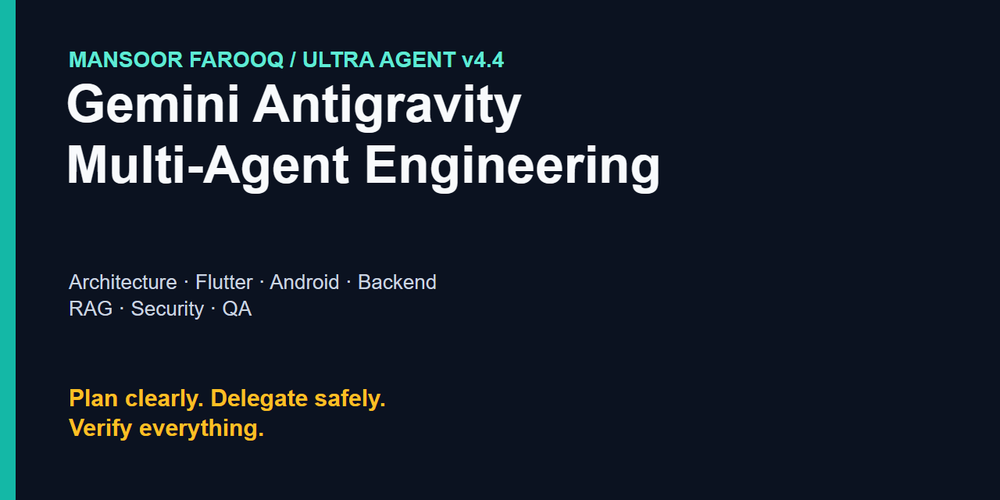
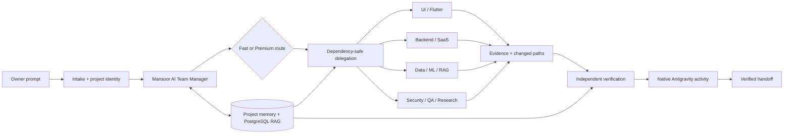
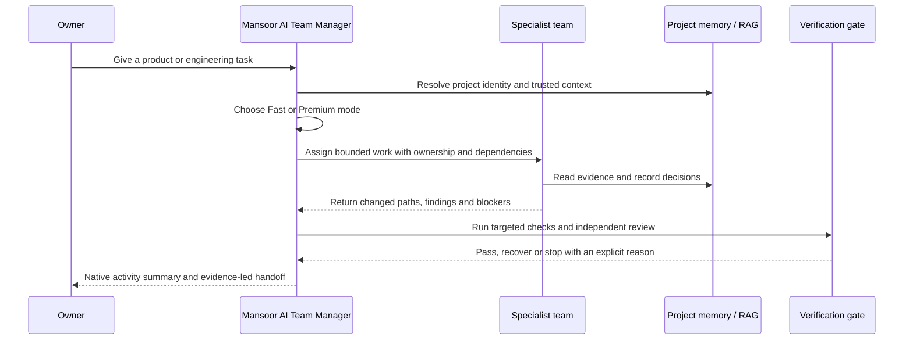

# Mansoor Farooq | Ultra Agent v4.4 Gemini Antigravity Multi-Agent Team

<div align="center">

### Gemini-powered Antigravity agent orchestration for production software engineering

**Plan clearly. Delegate safely. Verify everything. Ship with evidence.**

[](https://github.com/mansoor-farooq)
[](https://github.com/mansoor-farooq/my_ai_agent)
[](https://github.com/mansoor-farooq/my_ai_agent)
[](SKILL-PROVENANCE.json)

[Explore the repository](https://github.com/mansoor-farooq/my_ai_agent) · [Read the architecture](docs/architecture.md) · [Start quickly](docs/quickstart.md) · [See use cases](docs/use-cases.md)

</div>

> **Ultra Agent v4.4** is Mansoor Farooq's owner-led Gemini agent team for Antigravity: one manager, 14 focused specialists, local project memory, PostgreSQL RAG, evidence-gated verification and an owner-signed release path.

Ultra Agent helps you plan, delegate and verify work across software architecture, production UI, Flutter, Android, .NET, Node.js, Python, PyTorch, PostgreSQL RAG, security, QA and release engineering.

**Start with:** [quickstart](docs/quickstart.md) · [architecture](docs/architecture.md) · [use cases](docs/use-cases.md) · [releases](https://github.com/mansoor-farooq/my_ai_agent/releases)

> **Distribution note:** This repository is public for product discovery. The source/package distribution remains private-only until every bundled skill has a verified source and redistribution licence. No credentials, private chats or hidden reasoning are shipped.

## Why this exists

Most agent demos stop at “ask a model and get text back.” Ultra Agent is designed for the part that happens after the prompt: reconstructing an unfamiliar repository, selecting the right specialist, preserving project memory, checking the result and handing back observable evidence.

Mansoor Farooq built this system for production-minded software architecture, premium product UI, Flutter and Android, .NET and Node.js backends, Python and PyTorch systems, workflow automation, application security, QA and release engineering.

## The product in one view

| Signal | What it means |
| --- | --- |
| **1 manager** | **Mansoor AI Team Manager** (`production-orchestrator` internal id) owns intake, planning, delegation and final verification. |
| **14 specialists** | UI, Flutter, SaaS, ERP/schema, .NET, Node.js, Python, ML, cloud data, workflows, security, QA, research and hub operations. |
| **179 skills** | A portable, deduplicated skill library with explicit provenance tracking, including the Vercel UI pack. |
| **4 governed rules** | A signed metadata registry versions scope, precedence, evidence and verification; the installer reports drift and preserves locally customized rules. |
| **Local-first memory** | Project identity, decisions, evidence, conflicts and checkpoints stay scoped to the selected repository. |
| **Local managed MCP** | The installed Antigravity plugin bundles its own managed-task MCP server; no per-project MCP config, provider key or remote telemetry service is required. |

## Architecture at a glance





## How a task moves



## What makes the architecture premium

### Evidence before confidence

The manager reconstructs the repository before changing it. Research, assumptions, decisions, verification output and changed paths remain explicit so a human can audit the handoff.

### Memory that belongs to the project

Canonical project identity keeps temporary workers, evidence, checkpoints and PostgreSQL retrieval tied to the selected repository. Stale, malformed, unversioned or conflicting facts are surfaced instead of silently promoted.

### Contract-first execution

Every target project has a visible, root-level contract made of `plan/`, `flow/`, `status/`, `logic/`, `requirements/` and `test-cases/`. The manager audits these folders read-only first; missing folders require owner approval before bootstrap. Accepted requirements and architecture decisions are append-only and versioned. The managed Node executor enforces typed write scopes and protected paths for actions routed through it. The bundled Antigravity PreToolUse hook blocks protected or out-of-workspace native file mutations and forces fresh owner review for in-workspace writes and shell commands. Native changes remain outside the Node executor's effect ledger and idempotency guarantees.

The contract kernel is available through `node <hubRoot>/tools/ultra-agent-v2/contract.mjs audit|bootstrap` and is included in the portable package. `preflight.mjs` reports contract readiness without mutating the target project.

### Isolated task workspaces and reviewable delivery

The managed V4 runtime can pin a task to a detached Git worktree, resume only the same approved task/plan/base revision, and keep the owner checkout untouched while writes and registered checks run. Passing work produces a patch with a SHA-256 review ID; a trusted owner approval for that exact patch stages it in the main checkout. It never commits, pushes, or deploys automatically. This lane requires a trusted host adapter that calls the managed runtime; Antigravity's native editor is not automatically redirected into the worktree, and the package reports that boundary explicitly.

The Antigravity plugin bundles that host adapter as a local `mansoor-managed-runtime` MCP server. Antigravity loads it from the installed plugin's `mcp_config.json`; there is no per-project MCP file or separate MCP credential to configure. The manager passes the current project path to each tool call, while resumable worktrees live in plugin-specific local data. The Windows 10/11 launcher uses the Node runtime prepared by the installer. The feature is available when the plugin is installed and enabled; restart or reload Antigravity after upgrading.

### Speed without unsafe parallelism

Routine reversible tasks use Fast mode and a focused specialist. Architecture, security, migration, release and explicit research use Premium mode with planning, bounded research, independent verification and targeted recovery. Independent writes can run in safe waves; overlapping ownership is serialized.

### Native activity, not a second dashboard

Assignments, progress, blockers, handoffs and completed work appear in the Antigravity parent chat and native sub-agent panel. A separate browser dashboard is not required.

### UI specialist release gate

`mansoor-ui-specialist` is the priority web-interface specialist and now treats layout integrity as a release gate, not a styling preference. Before handoff it checks real component/state evidence, text wrapping and shrink rules, long-content and empty/error states, keyboard focus, 200% zoom, responsive breakpoints, and light/dark theme contrast. Fixed-height text boxes, clipped copy and inaccessible truncation are blockers. The specialist reuses the project’s existing routes, data contracts, permissions, tokens and primitives, then requires a rendered browser or project-preview inspection before calling the UI complete.

### Flutter/Android specialist release gate

`flutter-mobile-specialist` is the expert mobile UI/Android worker for adaptive Flutter and native Compose products. It requires a UI decision brief, compact-phone/standard-phone/tablet coverage, safe-area and keyboard handling, loading/empty/error/offline/permission states, text scaling and semantics, 60fps motion discipline, native capability probes, OEM compatibility evidence and focused analyzer/widget/golden/integration verification. It preserves existing navigation, API/database contracts, IDs, validation and permissions; arbitrary state-management or folder rewrites are outside a UI task.

### Release-quality gates

The hub includes reusable gates for real projects:

- Android runtime smoke: `node tools/android-runtime-smoke.mjs --package <application-id> --require-device --out <project>/.agents/android-runtime-smoke.json` (install, launch, back and optional deep-link evidence; offline/API-failure states remain explicit until an app-owned test hook exists).
- Flutter release gate: `node tools/flutter-release-gate.mjs --project <flutter-project> --out <project>/.agents/flutter-release-gate.json` (analyze, tests, APK build, size and measured-performance placeholders).
- Capability and manifest drift: `node tools/mobile-capability-preflight.mjs --project <project> --package <application-id> --capabilities auto --previous-report <old-report> --require-device`.
- Secret scan: `node tools/secret-scan.mjs <project>` (redacted findings only; values are never printed).
- Dedicated RAG CI: set `RAG_DB_NAME=mansoor_agent_rag_test` and `RAG_DB_PASSWORD`/`PGPASSWORD`, then run `node tools/rag-ci-gate.mjs`. A local PostgreSQL instance using trusted localhost authentication may be opted in with `RAG_DB_TRUST_AUTH=1` and an explicit loopback `RAG_DB_HOST`; the gate probes credentials before tests.
- Specialist benchmark: `node tools/agent-benchmark.mjs <records.json>` for acceptance, accuracy, p95 latency, regression and unsafe-action metrics.
- Antigravity supports Windows 10 and Windows 11. Host preflight reports platform support separately from sandbox status; Windows 10 is review-required and Windows 11 sandbox status remains unknown until the host probes it. The terminal sandbox specifically requires Windows 11 24H2+ with the August 2026 update.

The recommended device matrix is Samsung, Pixel and Xiaomi across Android 13, 14 and 16. A missing device or expired evidence stays `unverified` and blocks release claims.

### Capability wave

The reliability layer includes an idempotent managed-write adapter, ranked repository map, provenance-aware memory, bounded verifier convergence, redacted local traces, security fixtures and optional Flutter/Android Patrol/Maestro flow gates. The benchmark evaluator is ready, but no owner-approved live task corpus is bundled yet; no agent accuracy or competitor superiority claim is made. Native IDE tools are gated by the packaged PreToolUse hook, but the Node adapter does not track those native effects. On Windows 10, the CLI sandbox is unavailable, so host permission review remains required. Windows 11 is supported; sandbox capability must be probed on that machine.

## Capability map

| Product area | Built-in capability | Primary specialists |
| --- | --- | --- |
| Product architecture | Reverse engineering, SaaS boundaries, migrations, release decisions | `saas-architect`, `enterprise-schema-architect` |
| UI and mobile | Premium UI systems, Flutter, Android, browser-visible QA | `mansoor-ui-specialist`, `flutter-mobile-specialist` |
| Backend engineering | .NET, ASP.NET Core, Node.js, TypeScript, Python services | `dotnet-backend-specialist`, `node-backend-specialist`, `python-backend-specialist` |
| Data and ML | PostgreSQL RAG, cloud data, PyTorch, MLOps and evidence boundaries | `cloud-data-engineer`, `ml-systems-specialist` |
| Operations | Workflow automation, application security, release readiness | `workflow-automation-specialist`, `application-security-reviewer`, `qa-release-specialist` |
| Research and maintenance | Deep research, documentation, package health and provenance | `research-docs-specialist`, `agent-hub-maintainer` |

## Who it is for

- **Founders and product teams** who need a reliable engineering partner across UI, backend and operations.
- **Senior engineers** who want architecture-aware delegation instead of a generic coding chatbot.
- **Teams with long-lived repositories** that need memory, evidence, checkpoints and safe handoffs.
- **Owners of private agent programs** who need a signed, portable Antigravity package with clear boundaries.

## Start here

### For a recipient

1. Install Antigravity and sign in with the target user's Gemini account.
2. Obtain the approved signed `mansoor-agent-hub.zip` from Mansoor Farooq's owner distribution. The [GitHub releases page](https://github.com/mansoor-farooq/my_ai_agent/releases) will be used when a public release artifact is intentionally published.
3. Extract the ZIP and run `Install-Mansoor-Agent-Team.cmd`.
4. Open a project, select **Mansoor AI Team Manager** (internal id `production-orchestrator`), and give it a task in chat.

The installer verifies the signed package and runs strict Antigravity validation before installing or updating the team. See the [recipient quickstart](docs/quickstart.md) for the full flow.

### For the owner

```cmd
cd /d E:\Agents
npm run build
```

The build refreshes source checksums, signs the portable ZIP, runs the doctor, validates the plugin and executes the focused test suite. If a Mansoor Agent Hub installation already exists on that PC, it also runs the signed installer automatically, reports the update plan and verifies active-plugin/profile hashes. Use `npm run build:package` when you only want a ZIP without touching the local installation. See [owner setup](docs/quickstart.md#owner-build-and-release).

## Deep documentation

| Guide | Use it when you want to… |
| --- | --- |
| [Architecture](docs/architecture.md) | Understand manager boundaries, memory/RAG, delegation, verification and release safety. |
| [Quickstart](docs/quickstart.md) | Install the team, run the first task or build an owner-signed release. |
| [Use cases](docs/use-cases.md) | See how Fast, Premium, UI, backend, RAG, security and release tasks flow. |
| [Ultra Agent protocol](shared/ULTRA_AGENT_V2_PROTOCOL.md) | Read the runtime contract and project-scoped evidence model. |
| [Portfolio SEO copy](docs/PORTFOLIO_SEO.md) | Reuse accurate public product positioning and links. |
| [Skill provenance](SKILL-PROVENANCE.json) | Inspect source categories, declared licences and private-only boundaries. |

## Verification and release proof

The V4.4 release gate currently verifies:

- `npm test`: test totals are generated from the current run; the ordinary suite may skip six PostgreSQL-backed checks without a dedicated test database. CI runs the full eight-case RAG file against the isolated `mansoor_agent_rag_test` service and rejects any skip.
- 15 packaged agent profiles, 179 skills, 4 governed rules and zero provider connectors;
- owner-signed package checksums, strict Antigravity plugin validation and source integrity checks;
- benchmark envelopes for acceptance, latency, p95 timing and bounded failure reasons;
- checkpoint drift reporting, memory health diagnostics, activity summaries, capability probes, manifest drift, runtime smoke and expanded secret redaction.

The generated artifact is `dist/mansoor-agent-hub.zip`. Every build prints the exact SHA256 for the package that was produced.

## Fast and Premium modes

The manager selects the mode automatically. Fast mode handles routine reversible work with cached context and targeted verification. Premium mode handles architecture, security, production, release, payment, ML, migration and explicit research with planning, bounded research, specialist delegation, independent verification and evaluation. Missing Premium tools block the task instead of silently downgrading it.

## Trust, provenance and public boundaries

The public repository is a product showcase and discovery surface. The portable package remains private-only until the bundled skill inventory has complete source and redistribution review. `SKILL-PROVENANCE.json` is the source of truth; no licence or provenance is invented.

The package never includes provider credentials, customer data, private chats, hidden chain-of-thought or the private signing key. Tamper detection protects against accidental or ordinary unauthorized modification, but it is not unbreakable DRM.

## About Mansoor Farooq

**Mansoor Farooq** is the creator and owner of Ultra Agent. His engineering focus spans Antigravity and Gemini agent orchestration, software architecture, premium product UI, Flutter, Android, .NET, Node.js, Python, PyTorch, PostgreSQL, workflow automation, application security and release engineering.

- GitHub: [mansoor-farooq](https://github.com/mansoor-farooq)
- Repository: [my_ai_agent](https://github.com/mansoor-farooq/my_ai_agent)
- Releases: [Ultra Agent releases](https://github.com/mansoor-farooq/my_ai_agent/releases)

> **Search summary:** Mansoor Farooq's Ultra Agent v4.4 is a Gemini-powered Antigravity multi-agent system for software architecture, production UI, Flutter, .NET, Node.js, Python, PyTorch, PostgreSQL RAG, workflow automation, application security, QA automation and signed release engineering.
