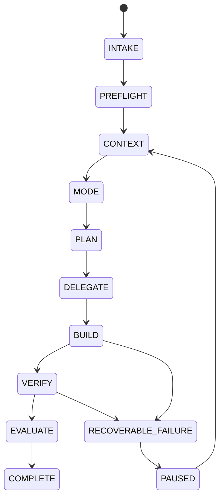

# Ultra Agent v4.4 Architecture

This document is the engineering companion to the [premium README](../README.md). It explains the boundaries that make Mansoor Farooq's Antigravity/Gemini agent team useful on long-lived repositories without turning project memory into a transcript archive.

## Component model

## Responsibility boundaries

| Component | Responsibility | Explicit non-goal |
| --- | --- | --- |
| `production-orchestrator` | Intake, project selection, routing, delegation, verification and handoff | Specialists never become managers or recursively delegate. |
| Specialist agents | Focused implementation, research, review or QA within a bounded scope | They do not bypass manager policy or rewrite unrelated project areas. |
| V2 runtime | Project identity, memory dossier, research/verification ledgers and retrieval | It does not store credentials, raw private chats or hidden reasoning. |
| V3 control plane | Task lifecycle, dependency-safe waves, policy checks, checkpoints and traces | It never hides a failed task by deleting state. |
| V4 adaptive runtime | Benchmark envelopes, native activity summaries and targeted recovery | It does not create broad rewrite loops or silently downgrade Premium work. |
| Managed executor + host hook | Governed rules, trusted approval callback, scoped atomic writes and idempotency receipts for managed writes; Antigravity PreToolUse hook blocks protected/out-of-workspace native mutations and forces fresh review for in-workspace writes and shell commands | Native changes remain outside the Node effect ledger/idempotency receipts; verify hook is active in Antigravity. |
| PostgreSQL RAG | Project-scoped lexical retrieval with source hashes and line ranges | It is not a cross-project memory store and does not replace source verification. |

## Runtime lifecycle

The lifecycle is durable and project-scoped. Each state event carries task identity, project identity, actor, transition and evidence references. Corrupt trailing events are quarantined during resume; valid history is preserved.

The additive managed executor composes the V4 lifecycle with the governed rule registry and effect ledger. It fails closed without a trusted approval adapter and only authorizes writes submitted through that adapter. The packaged PreToolUse hook separately gates native Antigravity tools: protected/out-of-workspace mutations are denied, and in-workspace writes and shell commands require fresh review. Native tool effects are not entered into the Node effect ledger. `node tools/antigravity-runtime-preflight.mjs` reports platform support separately from sandbox state; Windows 10 is review-required, Windows 11 is supported but sandbox remains unknown until probed. A platform build detection alone never counts as proof that sandboxing is active.

## Memory and RAG path

1. **Preflight** derives a stable project identity from the sanitized repository context.
2. **Memory** reads the project dossier, map, decisions, research ledger and verification ledger.
3. **RAG** retrieves project-local evidence from PostgreSQL with relative path, line range and source hash.
4. **Freshness checks** reject stale, malformed, unversioned or unrelated evidence from being silently promoted.
5. **Handoff** records concise decisions and observed results, never hidden chain-of-thought or raw chat transcripts.

The runtime uses `localhost` by default, excludes secrets, dependencies, binaries and private-profile trees, and treats retrieval as evidence that must still be checked against current source.

## Delegation and verification

- Only the manager delegates.
- Independent write ownership can run in safe waves; overlapping or unknown ownership is serialized.
- Parallel delegation is capped at three workers.
- Fast mode requires targeted verification.
- Premium work requires planning, research evidence and independent verification; high-risk failures receive targeted recovery with bounded retries.
- Checkpoints are hash-only manifests. `verify-checkpoint` reports modified, deleted, missing and outside-root paths; it never performs automatic rollback.

## Native activity model

The Antigravity parent chat is the concise activity log. The native sub-agent panel is the detailed live worker surface. Activity events cover assignment, progress, blockers, handoff and completion. A standalone browser dashboard is intentionally not part of the runtime because it only mirrored persisted files and could not represent live Antigravity work.

## Packaging and trust boundary

The portable ZIP contains the manager, specialists, owned skills, governed rules and local runtime utilities. It does not bundle provider connectors, credentials, customer data, private chats, hidden reasoning or the private signing key. `SKILL-PROVENANCE.json` is the authority for source categories, declared licences and private-only distribution boundaries.

For the full protocol, see [ULTRA_AGENT_V2_PROTOCOL.md](../shared/ULTRA_AGENT_V2_PROTOCOL.md). For package validation and release steps, see [quickstart.md](quickstart.md).
