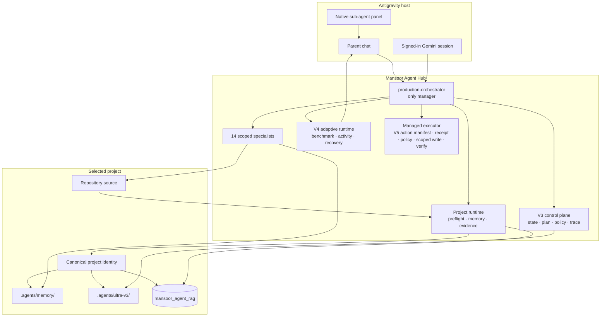
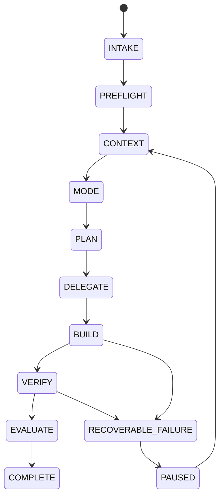

# Ultra Agent v4.4 Architecture

This document is the engineering companion to the [premium README](../README.md). It explains the boundaries that make Mansoor Farooq's Antigravity/Gemini agent team useful on long-lived repositories without turning project memory into a transcript archive.

## Component model

## Responsibility boundaries

| Component | Responsibility | Explicit non-goal |
| --- | --- | --- |
| `production-orchestrator` | Intake, project selection, routing, delegation, verification and handoff | Specialists never become managers or recursively delegate. |
| Specialist agents | Focused implementation, research, review or QA within a bounded scope | They do not bypass manager policy or rewrite unrelated project areas. |
| V2 runtime | Project identity, memory dossier, research/verification ledgers and retrieval | It does not store credentials, raw private chats or hidden reasoning. |
| V3 control plane | Task lifecycle, dependency-safe waves, policy checks, checkpoints and traces | It never hides a failed task by deleting state. |
| V4 adaptive runtime | Benchmark envelopes, native activity summaries and targeted recovery | It does not create broad rewrite loops or silently downgrade Premium work. |
| Managed executor + task worktrees + host hook | V5 action manifest binds project revision, exact write hashes, command arguments, policy version, expiry and nonce. A durable local approval/effect ledger records a manifest-bound receipt, state transitions, effect hashes, verification and patch promotion; replay is limited to the same action bytes. Scoped writes run in a detached Git worktree. The MCP adapter exposes inspect/prepare/run/review/promote/discard tools. | The local HMAC proves a receipt was recorded by this user's local runtime, not that a human identity or host click was cryptographically attested. A Git worktree is not an OS sandbox. No per-project MCP config is needed. Plugin must be installed/enabled and Antigravity reloaded. Native IDE writes remain outside the managed effect ledger and depend on the host hook. |

## Portable managed-task MCP adapter

`tools/ultra-agent-v4/mcp-server.mjs` implements a local stdio MCP server bundled at the Antigravity plugin root. `mcp_config.json` resolves the launcher through `PLUGIN_ROOT` and stores persistent workspaces under `PLUGIN_DATA`; neither path is hard-coded to the owner machine. The user installs/enables the plugin once per machine, not once per project. The project path is supplied to each tool call. `prepare_managed_action` is read-only and returns a canonical, short-lived manifest; `run_managed_task` requires that exact manifest, recomputes it from the submitted task/plan/actions and blocks mismatches before execution. A hash-chained append-only ledger under the selected project's ignored `.agents/ultra-v4/managed-runs/<taskId>/` stores approval, effect and run transitions; a per-run local key validates receipts after process restart. The receipt still is not a signed human identity attestation. `promote_reviewed_patch` and `discard_task_workspace` are eager tools and pass through the bundled PreToolUse review hook. Review tools expose the patch and its hash for review.

The packaged launcher supports Windows 10/11, uses Node.js on PATH or the installer-managed per-user runtime, and fails visibly if either runtime or plugin data is unavailable. The project itself must be a clean Git checkout for worktree isolation. This MCP is local-only and has no provider credentials or network endpoint. The Antigravity host must have the plugin installed and enabled; package creation alone does not activate it in an already-open host.

## Persistent CLI and Android preview lane

`tools/ultra-agent-v4/daemon/` is the shared local control plane for Antigravity and CLI use. `tools/ultra-agent-cli.mjs start` starts one lock-protected daemon; `submit`, `status`, `events`, `resume`, `stop` and `doctor` use the same persisted run records and event stream as the host adapter. The queue is durable when the host is unavailable, but execution still requires the signed-in Gemini/Antigravity session. The daemon does not provide provider fallback, hidden account switching or an OS sandbox claim.

`tools/ultra-agent-v4/android-preview.mjs` is an additive Android observation adapter. It discovers host `adb`/`scrcpy`, selects one online device (or blocks until a serial is supplied), starts a marked owned scrcpy process and emits `mansoor.android-preview/v1` evidence. The release gate may include that report, but a missing device or mirror is `unverified`; scrcpy visibility is not a substitute for analyzer, tests, build or app-owned runtime checks. The binary stays external to the package and is never silently downloaded or bundled.
| PostgreSQL RAG | Project-scoped lexical retrieval with source hashes and line ranges | It is not a cross-project memory store and does not replace source verification. |

## Runtime lifecycle

The lifecycle is durable and project-scoped. Each state event carries task identity, project identity, actor, transition and evidence references. Corrupt trailing events are quarantined during resume; valid history is preserved.

The additive managed executor composes the V4 lifecycle with the governed rule registry, durable effect ledger and detached task worktree. It blocks without an approval callback and local receipt authority, and only authorizes writes submitted through that path. The receipt binds the current invocation to the canonical action manifest; it does not independently prove a person clicked approval. The ledger records `prepared → approved → executing → reconciled → verified → promoted`, with a stable action key that excludes payload bytes and a separate payload hash that rejects changed bytes under a reused key. Each append is hash-chained and flushed before the next managed side effect. An interrupted write is reconciled against the exact destination hash and recorded preimage; an unknown destination state stops the run. Approval receipts survive MCP process restart in the per-run ledger, subject to manifest expiry. The owner checkout remains unchanged until patch review; promotion rechecks the base revision and stages the exact stored patch without committing, and repeat promotion reconciles rather than duplicating the stage operation. A task resumes only with the same project/task identity, manifest, plan hash, base revision and scope. The packaged PreToolUse hook separately gates native Antigravity tools: protected/out-of-workspace mutations are denied, while canonical in-workspace mutations are allowed as one scoped batch so a multi-file plan does not prompt once per file; shell commands and Tier 2/3 effects remain review-gated. Native tool effects are not entered into the Node effect ledger, and native editor writes are not automatically redirected into the worktree. Hook errors may be ignored by the host, so neither the hook nor its presence proves fail-closed execution or human identity; native effect completion is therefore reported as a separate, unverified host path. `node tools/antigravity-runtime-preflight.mjs` reports platform support separately from sandbox state; Windows 10 is review-required, Windows 11 is supported but sandbox remains unknown until probed. A platform build detection alone never counts as proof that sandboxing is active.

## Memory and RAG path

1. **Preflight** derives a stable project identity from the sanitized repository context.
2. **Memory** reads the project dossier, map, decisions, research ledger and verification ledger.
3. **RAG** retrieves project-local evidence from PostgreSQL with relative path, line range and source hash.
4. **Freshness checks** reject stale, malformed, unversioned or unrelated evidence from being silently promoted.
5. **Handoff** records concise decisions and observed results, never hidden chain-of-thought or raw chat transcripts.

The runtime uses `localhost` by default, excludes secrets, dependencies, binaries and private-profile trees, and treats retrieval as evidence that must still be checked against current source.

## Delegation and verification

- Only the manager delegates.
- Independent write ownership can run in safe waves; overlapping or unknown ownership is serialized.
- Parallel delegation is capped at three workers.
- Fast mode requires targeted verification.
- Premium work requires planning, research evidence and independent verification; high-risk failures receive targeted recovery with bounded retries.
- Checkpoints are hash-only manifests. `verify-checkpoint` reports modified, deleted, missing and outside-root paths; it never performs automatic rollback.

## Native activity model

The Antigravity parent chat is the concise activity log. The native sub-agent panel is the detailed live worker surface. Activity events cover assignment, progress, blockers, handoff and completion. A standalone browser dashboard is intentionally not part of the runtime because it only mirrored persisted files and could not represent live Antigravity work.

## Packaging and trust boundary

The portable ZIP contains the manager, specialists, owned skills, governed rules and local runtime utilities. It does not bundle provider connectors, credentials, customer data, private chats, hidden reasoning or the private signing key. `SKILL-PROVENANCE.json` is the authority for source categories, declared licences and private-only distribution boundaries.

For the full protocol, see [ULTRA_AGENT_V2_PROTOCOL.md](../shared/ULTRA_AGENT_V2_PROTOCOL.md). For package validation and release steps, see [quickstart.md](quickstart.md).
